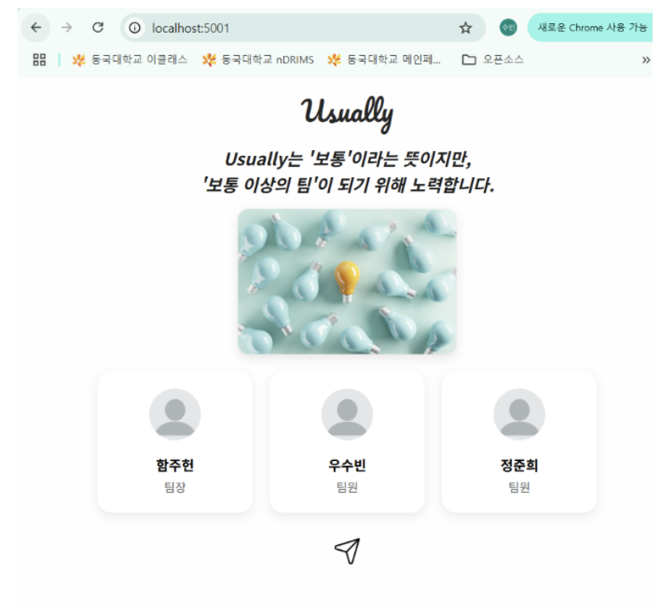

# 2025-1 OSS 실습 — Usually 팀 (01조)

> 동국대학교 2025년 1학기 오픈소스소프트웨어 실습 레포지토리입니다.

**팀명:** Usually &nbsp;|&nbsp; **팀원:** 함주헌 · 우수빈 · 정준희

> *"Usually는 '보통'이라는 뜻이지만, 보통 이상의 팀이 되기 위해 노력합니다."*

---

## 📌 프로젝트 개요

Flask 웹 애플리케이션을 단계적으로 발전시키며 **컨테이너화(Docker)** 와 **CI/CD(Jenkins)** 를 실습합니다.

| 과제 | 내용 | 핵심 기술 |
|------|------|-----------|
| **Subject 3-1** | 단일 Flask 폼 → Dockerfile 컨테이너화 | Flask · Docker · uWSGI · Nginx |
| **Subject 3-2** | 다중 학생 정보 입력·출력 웹앱 (팀 소개 페이지 포함) | Flask · 파일 업로드 · 개인정보 마스킹 |
| **teamsub5** | 프론트/백엔드 분리 → Docker Compose 멀티컨테이너 | Docker Compose · Jenkins CI/CD |

---

## 📂 레포지토리 구조

```
2025-1-OSSPracM/
├── main.py                        # 팀원 소개 출력 (Hello World)
├── Jenkins Pipeline script.txt    # Jenkins CI/CD 파이프라인 스크립트
│
├── Subject3_1/                    # 과제 3-1: 단일 컨테이너 Flask 앱
│   ├── Dockerfile
│   └── app/
│       ├── ex4.py                 # Flask 앱 (학생 정보 입력 폼)
│       ├── uwsgi.ini              # uWSGI 설정
│       └── templates/
│           ├── input.html         # 입력 폼 페이지
│           └── result.html        # 결과 표시 페이지
│
├── Subject3_2/                    # 과제 3-2: 팀 소개 + 다중 학생 정보 앱
│   ├── team.py                    # Flask 앱 (메인 서버)
│   ├── templates/
│   │   ├── intro.html             # 팀 소개 인트로 페이지
│   │   ├── index.html             # 학생 리스트 메인 페이지
│   │   ├── input.html             # 학생 정보 입력 폼 (최대 3명)
│   │   ├── result.html            # 입력 결과 표시 페이지
│   │   └── contact.html           # GitHub QR 코드 팝업
│   └── static/
│       ├── team_img.jpg           # 팀 사진
│       ├── send.png               # 버튼 아이콘
│       └── uploads/               # 업로드된 프로필 이미지 저장
│
└── teamsub5/                      # 최종 과제: 멀티컨테이너 배포
    ├── docker-compose.yml         # 프론트/백 동시 실행
    ├── FrontEnd/
    │   ├── Dockerfile             # uWSGI-Nginx-Flask 기반 (port 80)
    │   └── main.py
    └── BackEnd/
        ├── Dockerfile             # Python3 기반 (port 5001→5000)
        └── main.py
```

---

## 🔧 과제별 상세 설명

### Subject 3-1 — Flask 앱 컨테이너화

단일 Flask 폼을 Docker 이미지로 빌드해 실행합니다.

**앱 기능 (`ex4.py`):**
- `GET /` → 학생 정보 입력 폼 (이름·학번·성별·전공·사용 언어 체크박스)
- `POST /result` → 입력 내용을 테이블로 출력

**Dockerfile 핵심:**
```dockerfile
FROM tiangolo/uwsgi-nginx-flask:python3.9
# Flask + Nginx + uWSGI가 미리 설정된 베이스 이미지 사용
COPY ./app /app
```

**실행 방법:**
```bash
docker build -t subject3-1 ./Subject3_1
docker run -p 80:80 subject3-1
# 브라우저에서 http://localhost 접속
```

---

### Subject 3-2 — 팀 소개 웹앱 (Usually)

팀 브랜딩이 적용된 멀티페이지 Flask 웹앱입니다.

**구현 화면 (인트로 페이지):**



**페이지 구성:**

| URL | 페이지 | 설명 |
|-----|--------|------|
| `/` · `/intro` | 인트로 | 팀 소개, 팀원 카드, 팀 사진 |
| `/index` | 학생 리스트 | 입력된 학생 정보 카드형 목록 |
| `/input` | 정보 입력 | 최대 3명까지 동적 폼 추가 |
| `/result` | 결과 | 학생 카드 (프로필 이미지 + 정보) |
| `/contact` | QR 팝업 | 팀 GitHub QR 코드 |

**주요 기능 (`team.py`):**
- **프로필 이미지 업로드** — png·jpg·jpeg·gif 허용, `static/uploads/` 에 저장
- **전화번호 마스킹** — 끝 2자리를 `**` 로 자동 치환 (개인정보 보호)
- **동적 폼 추가** — JavaScript로 학생 블록 최대 3개까지 동적 추가
- **GitHub QR 팝업** — `/contact` 를 새 창으로 오픈

**실행 방법:**
```bash
cd Subject3_2
pip install flask werkzeug
python team.py
# 브라우저에서 http://localhost:5000 접속
```

---

### teamsub5 — Docker Compose 멀티컨테이너 + Jenkins CI/CD

프론트엔드와 백엔드를 **별도 컨테이너**로 분리하고, Jenkins 파이프라인으로 자동 빌드·배포합니다.

**컨테이너 구성:**

```
┌──────────────────────────────────────────────┐
│               Docker Compose                 │
│                                              │
│  ┌───────────────────┐  ┌──────────────────┐ │
│  │     FrontEnd      │  │     BackEnd      │ │
│  │ uWSGI+Nginx+Flask │  │  Python3 Flask   │ │
│  │    port 80:80     │  │  port 5001:5000  │ │
│  │  (Subject3_1 앱)  │  │  (Subject3_2 앱) │ │
│  └───────────────────┘  └──────────────────┘ │
└──────────────────────────────────────────────┘
```

**Docker Compose 실행:**
```bash
cd teamsub5
docker compose up --build
# FrontEnd: http://localhost
# BackEnd:  http://localhost:5001
```

**Jenkins CI/CD 파이프라인 (`Jenkins Pipeline script.txt`):**

```groovy
pipeline {
    agent any
    environment {
        DOCKER = credentials('docker-hub')  // Docker Hub 인증 정보
    }
    stages {
        stage('Prepare') { /* GitHub main 브랜치 클론 */ }
        stage('Build')   { /* docker compose build backapp */ }
        stage('Tag')     { /* 이미지에 Docker Hub 태그 부착 */ }
        stage('Push')    { /* Docker Hub에 이미지 푸시 */ }
    }
}
```

파이프라인 흐름:

```
코드 Push → Jenkins 감지 → GitHub Clone → Docker 빌드 → Docker Hub Push
```

---

## 🛠️ 기술 스택

| 분류 | 기술 |
|------|------|
| 웹 프레임워크 | Python Flask |
| 템플릿 엔진 | Jinja2 |
| 웹 서버 | uWSGI + Nginx (`tiangolo/uwsgi-nginx-flask`) |
| 컨테이너 | Docker, Docker Compose |
| CI/CD | Jenkins |
| 스타일링 | CSS3 (Google Fonts: Pacifico, Nanum Gothic) |

---

## 🚀 전체 실행 가이드

### 1. Subject 3-1 단독 실행
```bash
docker build -t subject3-1 ./Subject3_1
docker run -p 80:80 subject3-1
# http://localhost
```

### 2. Subject 3-2 단독 실행
```bash
cd Subject3_2
pip install flask werkzeug
python team.py
# http://localhost:5000
```

### 3. teamsub5 멀티컨테이너 실행
```bash
cd teamsub5
docker compose up --build
# FrontEnd → http://localhost
# BackEnd  → http://localhost:5001
```

### 4. Jenkins 파이프라인 설정
1. Jenkins에서 **Docker Hub 자격 증명**을 ID `docker-hub` 로 등록
2. `Jenkins Pipeline script.txt` 내용을 새 Pipeline Job에 붙여넣기
3. 빌드 실행 → GitHub Clone → Docker 빌드 → Docker Hub Push 자동 수행

---

## 👥 팀원

| 이름 | 역할 |
|------|------|
| 함주헌 | 팀장 |
| 우수빈 | 팀원 |
| 정준희 | 팀원 |

> 팀 GitHub: [CSID-DGU/2025-1-OSSPrac-usually-01](https://github.com/CSID-DGU/2025-1-OSSPrac-usually-01)
